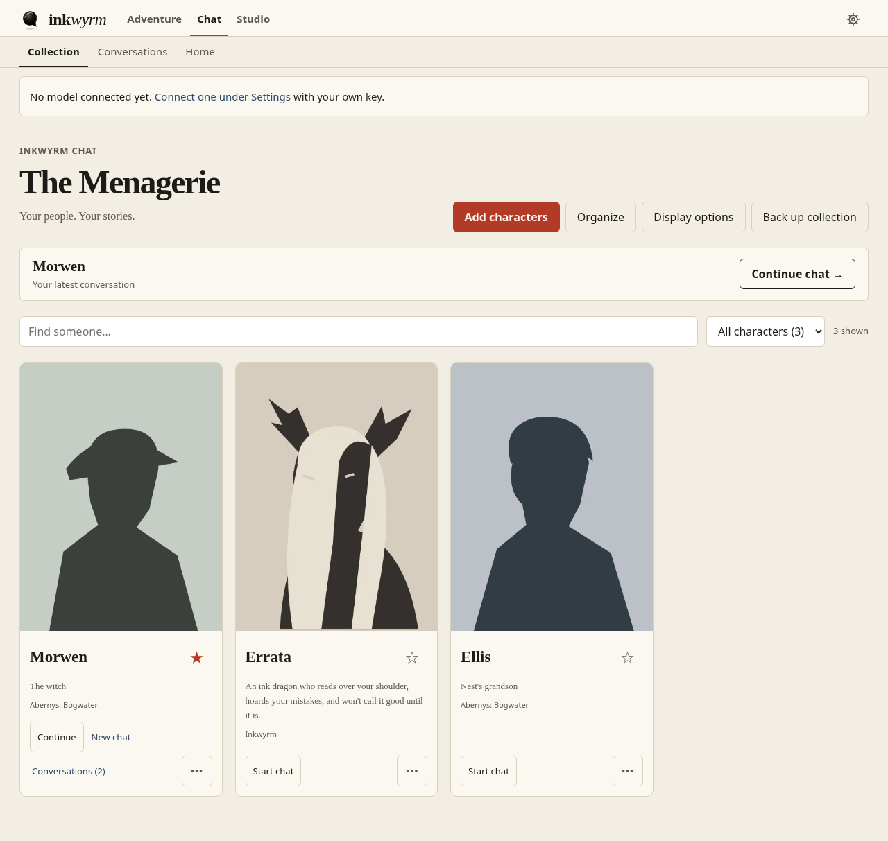

# Chat: your collection

Nov 12, 2026 · @AmbiProp · Chat 0.4.0; Overview 0.2.0.

Chat opens on a personal portrait collection. Importing a whole world no longer puts its entire NPC cast into that gallery. Characters remain shared world records: adding one to Chat creates neither a copy nor a second identity, and removing one never deletes their writing, conversations or adventure state.

## Character card controls

Each card provides a picture/name link to the character page, Favorite, Start chat or Continue, New chat when a conversation exists, a conversation chooser when there are several, and a labelled management button. Everything works by keyboard and touch; there are no hover-only actions.

Manage character offers Add/Remove from Chat, Archive/Unarchive, favorite, shelf membership, Move earlier/later within the current favorite group, Edit in Studio, image fit and focal-point controls, and artwork uploads. A preview shows framing changes. The character page has About, Conversations and Images; image management includes a stable gallery cover, avatar and all 24 emotion slots. Gallery artwork does not switch with a chat's latest mood.

The last conversation deliberately selected for a character is remembered independently from autosave timestamps. Continue uses that selection. The small collection Continue strip uses successful cross-site navigation activity, then a recent-save fallback. Conversations has the complete history, including characters no longer in the gallery.

## Curation and display

- Rename the collection: Menagerie, Harem, Companions, or another name.
- Make, rename, reorder and remove shelves; a character can belong to several. Shelves do not change in-story bonds or factions.
- Favorite, archive and manually order characters. Favorites form the first group in manual order.
- Search names, lines, tags and source worlds. The world-cast picker has its own search, so it does not accidentally filter the gallery afterward.
- Choose Portrait gallery or Compact list, Comfortable/Compact/Large card size, manual/name/recent sort, whether descriptions and source-world labels are shown, and Still/Selected/Visible animation.
- The chosen shelf and display options survive reloads and are included in Chat backups.

Use **Add characters** to import an individual JSON/PNG card, create a named character and open it in Studio, or choose people individually from existing worlds. Whole-world and module imports remain world cast by default. A one-off conversation from Studio does not enroll a world cast.

The Studio's Chat door has **Show in Chat by default**, stored as optional `chatListed` on the character. Individual card imports set that default. It survives world files and module conversion and has no effect on Adventure's character selection or rules. Explicit personal removal/archive takes precedence over that author default.

## Existing libraries and storage

`kit/src/collection.ts` owns a validated, bounded `inkwyrm.chat.collection.v1` navigation/presentation record. Members are keyed by the pair of world and character IDs, not display names. It holds the collection title, membership, shelves, favorites, order, framing, last selected conversation and display options. These are personal choices and never enter narration prompts.

After successful world and chat reads, a one-time initialization keeps established chat contacts, characters individually imported into Chat, and the bundled muse. Other world characters remain in the picker. After initialization, an old conversation or a world refresh cannot undo a removal. Failed library reads do not initialize an empty collection, delete preferences or authorize overwriting an unread import world. Retry retains the last successfully read data.

A browser that refuses preference writes keeps changes for the visit and reports that they are not saved. The backup reads the same in-memory view, so it can preserve those choices. Existing database and provider-key names are unchanged.

Overview reads the same membership and ordering, includes chosen artwork, and excludes hidden/archived characters from recommendations and Continue. Once a collection is initialized, a deleted stored house is not advertised again as a bundled character with a broken destination.

## Animated images

`kit/src/media.tsx` preserves original PNG/APNG, GIF, WebP, JPEG and AVIF bytes. The file is identified from its bytes rather than its filename. Canvas creates a separate static WebP poster; it never replaces the original. Stored image metadata includes dimensions, animation detection and a revision identifier. Current upload limits are 32 MB per image.

Originals and posters remain in the existing portrait store, without a database rename or destructive migration. The gallery reads small posters and lazy references using a cursor, rather than retaining every full original in React state. A bounded cache loads originals on demand. Updating an image invalidates its cached revision, even when its first frame has not changed.

The shared image component is used for gallery covers, avatars, emotion portraits, Home backgrounds/layers/figures, Settings previews, Overview and conversation images. New uploads and embedded card images keep animation. Legacy data URLs still work; local legacy animations can derive a poster without changing their stored original.

Automatic playback respects operating-system reduced motion. Explicit image controls can play a selected image, and global display options choose Still, Selected or Visible. Offscreen or hidden-tab images release playback. GIF/APNG/WebP playback is stopped by changing the image source to its poster, rather than trying to pause it with CSS. External conversation images without a local poster use a manual-play placeholder in Still/reduced-motion mode; they are not fetched through a cross-origin canvas.

Chat backups include original image bytes, posters, animation metadata, lives, posts, worlds, chats and collection curation. Restoring an older backup without collection data leaves current curation intact. Adventure saves and Studio authoring talks/drafts keep their own existing exports.

## Navigation

The shared logo/wordmark leads to `/overview/`. The section names lead to each section's own library; Adventure remains at `/` until the planned front-door migration. Chat's compact conversation header also has an Overview mark and a separate Back control. Adventure play keeps its header-free layout, with an Overview link in Settings.

Chat and Studio flush pending text saves and await in-flight writes before following the logo to Overview. An active reply is stopped and its partial text is kept first. Failed saves leave the editor open and report the problem. Shared sheets return focus to their opener and keep keyboard traversal out of folded details. Character pages open at the top; returning restores the collection's search and scroll position.

New Chat addresses are `#/character/<world>/<record>` and `#/conversations`. Existing `#/chat/<id>`, `#/with/<world>/<record>`, `#/home` and `#/settings` links remain valid. Opening a character page or new-chat setup creates no chat and makes no model request.

## Verification

Browser coverage includes importing Bogwater without adding its cast to the gallery; individual additions; favorites, shelves, names and framing; per-card conversation selection; archive and reload; keyboard trap/focus return; display persistence; Paper/Night; widths of 320, 390 and 1280 px; and zero generation requests during collection use.

Two-frame GIF, APNG and animated WebP files were uploaded through the actual UI. Their stored originals matched the input bytes exactly; that equality and animation metadata also survived backup and restore.

Repository checks passed: `npm test` (701 tests, including Adventure's module round-trip suite), `npm run lint` and `npm run build`. The final scroll-timing correction was also checked with all 32 Chat tests and a fresh Chat build. Real Chromium coverage against the production Express mounts checked all four entry points and their built assets, logo destinations, pending Studio edits and Chat drafts, one-off NPC isolation, character creation in Studio, and collection search/scroll restoration. A 390 px view with text sizes doubled had no horizontal overflow. Collection operations made no generation requests.

Screenshots use isolated browser fixture data. The artwork is from the earlier front-page composition sketches, uploaded through the same controls a user uses; it is not shipped or represented as approved character art.

[Phone, Paper](screens/gallery-phone-paper.png) · [Phone, Night](screens/gallery-phone-night.png) · [Character controls](screens/character-controls.png) · [Display options](screens/display-options.png).
