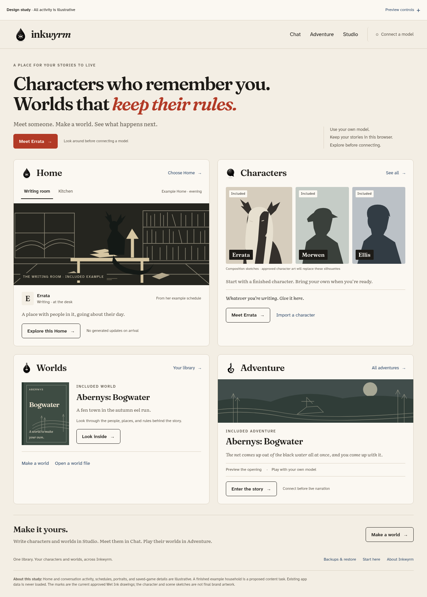
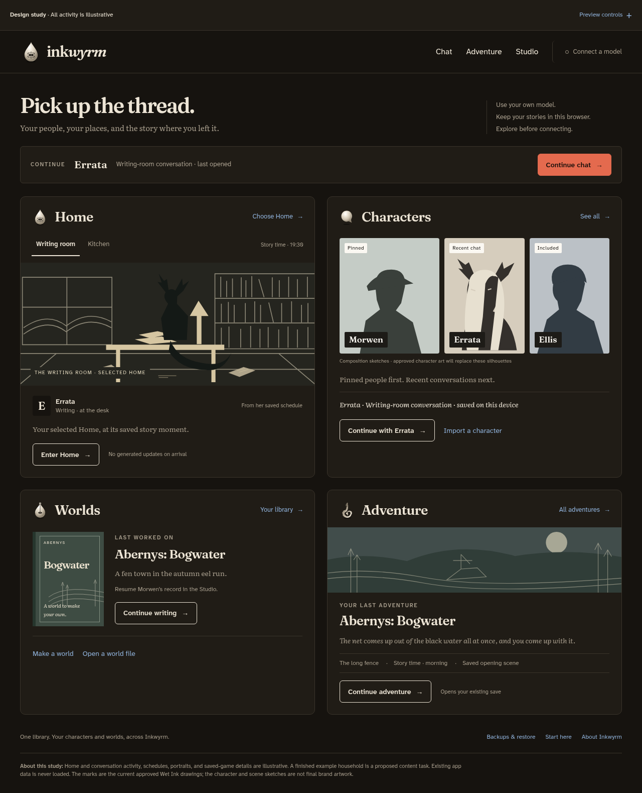

# Inkwyrm front page: build handoff

Nov 12, 2026 · @AmbiProp · Groundwork requested by the owner; application integration has not begun.

Inkwyrm needs a face of its own. Its front page is an illustrated dashboard: included examples explain the service on a first visit; the same places become useful shortcuts as someone builds a library. Studio keeps its job of authoring worlds. **Home** continues to mean an inhabited place, not the site's root page.

The owner asked for groundwork another chat can run with, a mockup, and effects that have presence without becoming tacky or overdone. This folder supplies that handoff. It adds no application routes, changes no storage, and makes no model calls. It was refreshed against main at `3b0efb0`: Studio 0.14.0, Adventure 0.27.1, Chat 0.3.1. Studio's exact routes and the shared site header have already shipped; reuse them.

## Start here

- [Implementation plan and code map](implementation.md): current capabilities, proposed contracts, routes, phases, and checks.
- [Visual and motion specification](visual-and-motion.md): composition, responsive behavior, interaction limits, and artwork handoff.
- [Prompt for the implementation chat](next-chat.md): ready to copy into a new session.
- [Interactive mockup](mockup/index.html): one standalone HTML file, including fonts and approved marks. Download and open it in a browser; GitHub's file viewer displays source rather than running HTML.
- [Validation record](validation.md): browser coverage, repository checks, and remaining limits.
- [How it fits the work so far](integration.md): the Studio's drafts, Errata and maps on the front page, what the front page asks of the Studio, and the build order beside the worldbuilding phases. A plan, awaiting the owner.

To preview from a checkout, run `python3 -m http.server 5191 --directory docs/front-page/mockup` from the repository root and open `http://localhost:5191/`. No installation or build is needed. The file also works directly from disk.

**Preview controls**, at the upper right, switches among First visit, Returning, One recent chat, Examples hidden, Storage unavailable, and Loading. It also offers Paper/Night, a motion toggle, and Replay entrance. The controls and destination dialogs belong to the study, not the product. URL parameters make a state reproducible: `?state=returning&theme=night&motion=off`.

## The composition

The top holds the Inkwyrm wordmark, direct links to Chat, Adventure and Studio, and connection settings. The first visit carries the existing brand promise:

> Characters who remember you. Worlds that keep their rules.

The following line offers a small, concrete invitation: *Meet someone. Make a world. See what happens next.* A prominent **Meet Errata** action appears here, before the panels, so a visitor on a phone can act without scrolling through the full showcase. Use your own model and browser-local storage are visible before any setup.

After meaningful use, the introduction contracts to *Pick up the thread.* A single Continue strip opens the last valid activity. The four panels retain their positions:

| Wide-screen position | Panel | What it does |
| --- | --- | --- |
| Upper left | Home | A room illustration, residents placed by their schedules, readable activity, and Enter Home |
| Upper right | Characters | A small, expressive cast; pins, recent conversations, then included characters |
| Lower left | Worlds | Covers and authorship; inspect an included world or resume writing an exact record |
| Lower right | Adventure | Scene art, a saved excerpt and current situation; open the exact save |

On a phone, those panels become one column in the same order. Continue stays above them, so a returning player can open their adventure without scrolling past Home. At the bottom, provide Backups & restore, a starting-page preference, and About Inkwyrm. A first-visit closing invitation points to world creation.

Phone compositions: [first visit](mockup/screens/first-paper-phone.png) and [returning visit](mockup/screens/returning-night-phone.png).

## The panel behavior

### Home

Use a selected world/scenario/room, remembered as navigation state. Show the scene and a text equivalent: who is present, what their schedule says, and which clock is being represented. Selecting a resident enters their Home context. Enter Home preserves the selected room. Changing a room updates its selection and text together; it never moves a resident.

Read through the shared schedule, relationship and placement rules. Honor private rooms before building images, resident lists, counts, activity text or accessible labels. Do not reveal a hidden room by saying someone is there. Empty rooms remain believable: nobody being in the kitchen is useful information.

The example writing room and Errata's evening schedule in this mockup are proposed content. They do not currently exist in the bundled house world. The scene is a composition sketch. Do not ship a dashboard that advertises this room while its destination opens Home setup instructions.

The panel initially shows schedule facts. When Chat supports posts, a short strip can show a real saved post with its author and time. Do not put an empty social feed, fake unread badge, or generated post on the launch page. Opening the dashboard makes zero model requests and does not mark Home's away log as read.

### Characters

Select up to three visible characters in this order: explicit pins, distinct characters from intentionally opened conversations, then included examples that fill free places. Deduplicate by world and record identity. The first item receives the lead artwork slot. Pin order is user-defined; recent order is last opened; included order is editorial. Keep that order stable across reloads.

For a recent character, Continue opens their last intentionally used conversation, preserving persona and scenario. Other conversations remain available in their detail view. Meet opens a preview and setup; New conversation is explicit. Opening the dashboard or preview creates no chat. Use the actual saved message excerpt if shown, never a fabricated live reply.

The mockup's first visitor sees Errata, Morwen, and Ellis. Those names come from existing material, but Morwen and Ellis are candidates pending finished chat content and artwork. A public launch collection should eventually demonstrate a genre outside fantasy as well.

### Worlds

Show a pinned or recently worked-on world; fill unoccupied positions with clearly labelled included worlds. The lead card has cover art, name, a short premise, and a useful authorship action. Continue writing returns to a real world/record and restores the editor's position where supported.

Look inside an included world should allow inspection before Make a copy. Copies and imports keep the current collision protections. Creating or editing a world stays in Studio. The dashboard is not a second authoring surface. A world's canon and an adventure's saved module remain distinct: editing a world does not silently rewrite a running game.

### Adventure

Show the last intentionally opened valid save, with world/save name, saved place, story stamp, and a short saved scene excerpt. Add a current condition or pending check only through existing engine readers. Omit missing details rather than filling them with guesses. Preserve the current save's module snapshot.

Continue opens that save, including any unresolved check. New adventure is a separate action. With no save, show an included opening labelled as an example. Inspecting an opening is free; generation needs the user's connected model. Never generate a fresh recap on every visit.

## Visit states and defaults

| State | Expected behavior |
| --- | --- |
| First visit, no meaningful activity | Brand introduction and finished included examples; no Continue strip |
| Returning with useful activity | Compact introduction, last valid activity, personal content in each relevant panel |
| One recent chat, no other activity | Continue chat; that character plus included fillers; Home/world/adventure examples remain labelled |
| Examples hidden, empty personal library | Compact invitation and useful create/import/choose actions; respect the dismissal |
| A local store fails | Explain the failed read without declaring the library empty; retain valid panels and offer Retry |
| Loading | Stable reserved panel space with static placeholders; decide first/returning presentation after reads settle |

Bundled content, schema upgrades, an automatic reconnect, a dashboard visit and background autosave do not count as meaningful activity. The first successful intentional open, creation or import does. For existing installations, valid saved chats/adventures and a clearly personal world can supply a conservative fallback until explicit activity metadata is written. Do not invent a cross-app "last opened" timestamp from unlike `updatedAt` fields.

The dashboard can be bypassed. Offer starting-page choices for Dashboard, Last activity, Studio, Chat and Adventure. Apply the preference only to a plain entry point. Deep links, imported-file flows, legacy launch links, browser Back, and explicit Overview clicks take precedence. Resolve missing targets with an explanation and a useful local destination; avoid redirect loops.

## The content that makes this work

The page needs a small finished starting collection, not a larger empty catalogue:

1. **Errata:** approved key art and portraits, greetings and examples, an authored schedule, and a room she inhabits.
2. **An example Home:** a scenario with rooms, room art, resident placement, a useful daily round, and a tested route into it. Errata's writing room is the suggested first choice. Additional residents need coherent reasons to be there.
3. **Bogwater:** an inspectable Studio world and a playable Adventure opening, with a recognizable cover/scene family. Existing module content is the source.
4. **A second character or setting:** eventually show the service's breadth outside fantasy. Choose and finish it as content work.

Errata's current bundled record in `chat/src/errata.ts` is the textual source. The older mascot brief contains superseded appearance details; it says the design is locked in the owner's CharacterVault. Use approved vault art when available. The mockup silhouette sets composition only and is not a replacement design.

Include a content manifest that distinguishes the shipped version from a user's editable copy. Show examples without writing them into the personal library. Installing or copying content is explicit. Respect dismissed examples and deleted bundled material; do not let a front-page refresh quietly recreate it.

## How much is decided

The owner authorized groundwork around this direction and a mockup. The page's responsibilities, four areas, first/returning distinction, local-first behavior, direct resumption and restrained motion form this handoff. Pixel details, final artwork, the next non-fantasy example, and later Home posts remain implementation/content choices.

This builds on the shipped UI decision in `docs/bids/ui/decision.md`: the Studio's writing page and doors, exact page addresses, the shared header, and Adventure in Wet Ink. It does not reopen that decision, rewrite a bid, authorize a new Adventure reading layout, or move the roadmap's other work. Build the remaining continuity first; give the root address to the dashboard once compatibility is proven.
